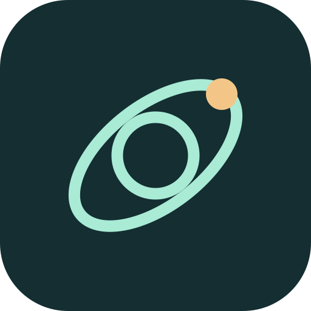
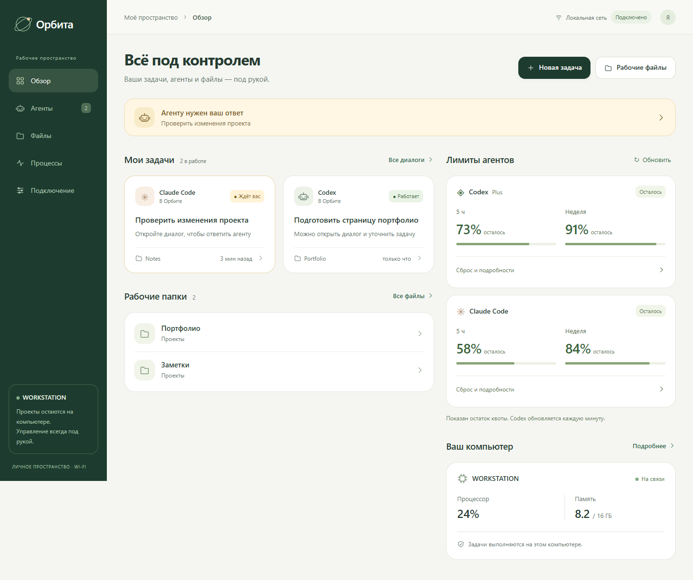
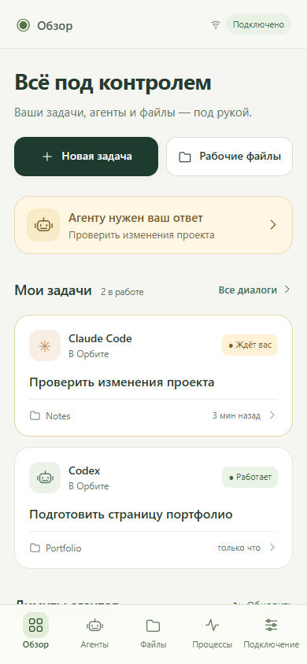
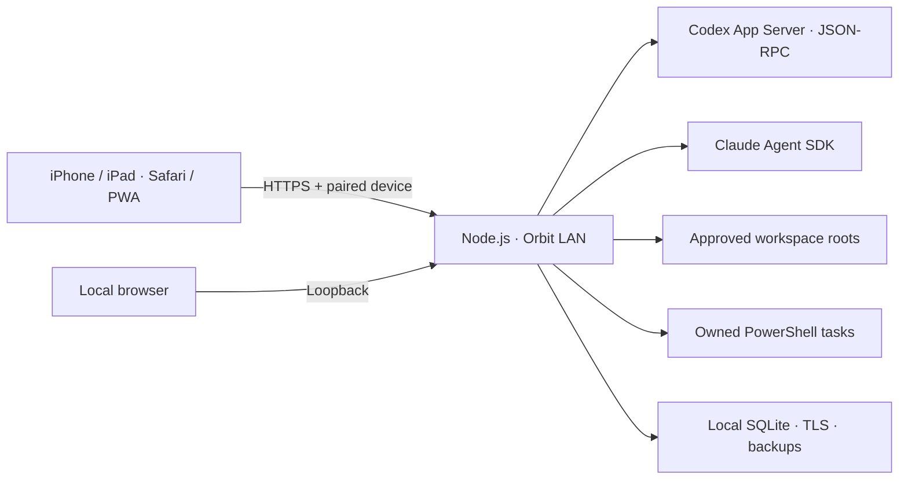

<p align="center"></p>

# Орбита · Orbit LAN

Личный центр управления проектами и AI-агентами с iPhone, iPad и компьютера в одной локальной сети.

[](https://github.com/kpk1310032003cy10-hue/orbit-lan/actions/workflows/ci.yml)
[](https://nodejs.org/)
[](LICENSE)

Орбита работает на вашем ПК. В браузере телефона доступны диалоги агентов, рабочие файлы, журналы команд и показатели компьютера. Интерфейс устанавливается на экран «Домой» из Safari как PWA.

**Статус:** ранняя рабочая версия. Основной хост — Windows; проверки серверных модулей также запускаются на Linux. Подключение через интернет в текущую версию не входит.



<details>
<summary>Интерфейс на телефоне</summary>



</details>

На изображениях — демонстрационные данные, не реальные проекты или показатели аккаунта.

## Возможности

- **На телефоне:** нижняя навигация, кнопки от 44 px, диалог на весь экран и черновики при переходах. Лимиты видны на главной и компактной строкой в переписке.
- **Codex и Claude Code:** новые сессии в выбранной папке, сообщения, ответы, запросы разрешений и остановка задач из Орбиты. Для Codex доступны поток ответа и уточнения выполняемой задачи.
- **История Codex / VS Code:** просмотр существующих диалогов и продолжение отдельной веткой. Сервис не перехватывает канал управления открытого расширения.
- **Лимиты:** остаток квоты Codex по каждому окну, время сброса по Москве, дополнительные кредиты и доступные сбросы. Для Claude — сведения из событий официального SDK, когда провайдер их передаёт.
- **Файлы:** просмотр подключённых директорий, скачивание и правка текстовых файлов до 1 МБ с резервной копией и проверкой конфликта изменений.
- **Команды:** запуск PowerShell в рабочей папке, журнал UTF-8 и остановка своего дерева процессов.
- **Мониторинг:** CPU, память и выбранные процессы Windows.
- **Устройства:** HTTPS, одноразовое сопряжение, отзыв доступа и общее состояние на телефоне и планшете.

## Быстрый запуск

Требуются **Windows**, **Node.js 24+** и **Git**. Codex обнаруживается в установленном расширении VS Code или в `PATH`; для работы с провайдером нужен его аккаунт.

```powershell
git clone https://github.com/kpk1310032003cy10-hue/orbit-lan.git
cd orbit-lan
npm ci
npm start
```

Панель на компьютере: **http://127.0.0.1:8787**.

Для запуска в фоне используйте **[Открыть Орбиту.cmd](Открыть%20Орбиту.cmd)**. При первом запуске без зависимостей сценарий выполнит `npm ci`.

1. Откройте панель и раздел **Подключение**.
2. Запустите **Разрешить доступ по Wi-Fi.cmd** и подтвердите системный запрос Windows для ограниченного сетевого правила.
3. На iPhone / iPad в той же сети отсканируйте QR-код. Установите сертификат с ПК, сверив его отпечаток, и включите доверие в настройках iOS.
4. Откройте защищённую ссылку и введите одноразовый код из панели ПК.
5. В Safari выберите **Поделиться → На экран Домой**.

При новой установке доступна только папка самого проекта. Другие корневые директории подключаются из панели на компьютере. Существующая пользовательская конфигурация сохраняется при обновлении.

Подробности: **[подключение устройств](docs/setup.md)** · **[настройки и обслуживание](docs/configuration.md)** · **[быстрая памятка](НАЧАТЬ%20ЗДЕСЬ.md)**.

## Границы возможностей

- Компьютер должен быть включён, подключён к сети и запускать Орбиту. iOS может приостанавливать интерфейс в фоне; работа на ПК продолжается, данные синхронизируются при возвращении.
- Полное управление доступно сессиям, запущенным из Орбиты. Мгновенная остановка сессии другого процесса VS Code не поддерживается.
- Для Claude выполните **Войти в Claude.cmd** на ПК и обновите статус. Импорт существующих диалогов расширения Claude не реализован; интеграция без авторизованного аккаунта проверяется только на уровне адаптера.
- Очередь внешнего Codex использует экспериментальный API. Принятие сообщения в очередь не подтверждает, что другой клиент уже обработал его.
- Остатки квоты отображаются в процентах. Пропущенное значение не считается 100%, устаревшие сведения помечаются, прошедшее время сброса не означает подтверждённого восстановления.
- Локальная сеть используется для доступа телефона к ПК. Сами агенты обращаются к OpenAI / Anthropic через интернет и используют ваш тариф.

## Архитектура



Исходники не содержат пользовательского состояния. По умолчанию оно находится в `%LOCALAPPDATA%\OrbitLAN`: база, сертификаты, ключи, резервные копии и журналы. Клиенту выдаётся только публичный сертификат. Service worker кэширует оболочку приложения; диалоги, файлы и API-ответы в Cache Storage не сохраняются.

Подробная модель доверия и сообщение об уязвимости: **[SECURITY.md](SECURITY.md)**.

## Разработка и проверка

```powershell
npm ci
npm run verify
npm run browser:test
```

- `npm run check` — синтаксис всех серверных, браузерных и тестовых модулей.
- `npm test` — границы файлов, сопряжение, сертификаты, агенты и лимиты на изолированных данных.
- `npm run format:check` / `npm run format` — единое оформление исходников и документации.
- `npm run check:publication` — проверка отслеживаемых Git файлов на случайно включённое состояние, ключи, распространённые токены и абсолютные пользовательские пути. Это дополнение к ручной проверке.
- `npm run browser:test` — отдельный сервер на портах 8797/8798, временная база и установленный Chrome. При необходимости укажите `ORBIT_CHROME_PATH`.

Браузерные сценарии проверяют настольные, iPhone и iPad размеры, загрузку файлов, UTF-8 вывод команды, остановку процесса, HTTPS-сопряжение, отзыв доступа и PWA. Они не подтверждают работу на физических iOS устройствах. Модельные запросы в тестах не отправляются.

Сборки нет: браузерные ES modules и Node.js. `private: true` в `package.json` предотвращает случайную публикацию пакета в npm; исходный код репозитория открыт.

Правила изменений и атомарных коммитов: **[CONTRIBUTING.md](CONTRIBUTING.md)**. План: **[ROADMAP.md](ROADMAP.md)**. Изменения: **[CHANGELOG.md](CHANGELOG.md)**.

## English overview

Orbit LAN is a personal Windows-hosted dashboard for Codex, Claude Code, project files and command logs. Its responsive PWA runs on iPhone, iPad and desktop browsers. Devices pair over HTTPS within the selected local subnet. Agent inference still uses the provider's online service and account. Existing VS Code sessions can be inspected and forked; full control applies to sessions created by Orbit. Internet exposure is not configured or supported by this release.

## Интеграции и лицензия

Используются [Codex App Server](https://learn.chatgpt.com/docs/app-server), [Codex CLI](https://learn.chatgpt.com/docs/cli/reference), [Claude Agent SDK](https://code.claude.com/docs/en/agent-sdk/permissions) и [Claude Code CLI](https://code.claude.com/docs/en/cli-reference). Некоторые методы Codex экспериментальны и могут измениться при обновлении CLI.

Код Орбиты распространяется под **[MIT](LICENSE)**. Зависимости имеют собственные лицензии — см. [THIRD_PARTY_NOTICES.md](THIRD_PARTY_NOTICES.md). Проект независимый и не является официальным продуктом OpenAI, Anthropic или Apple.
